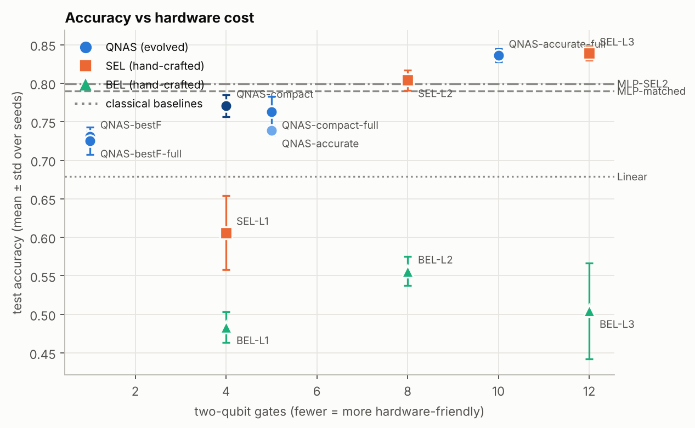
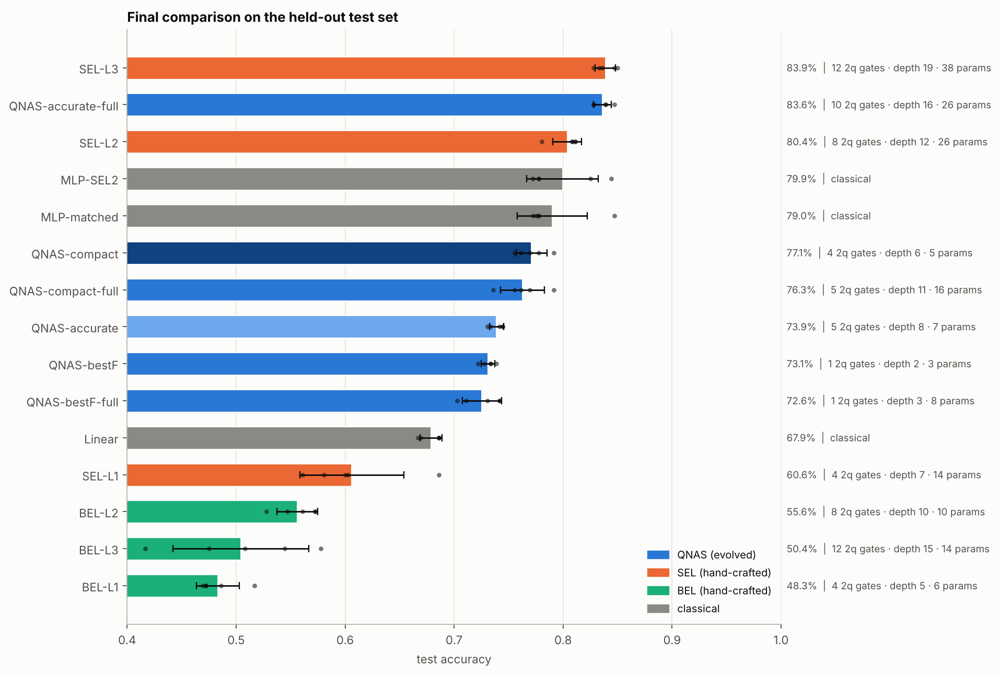
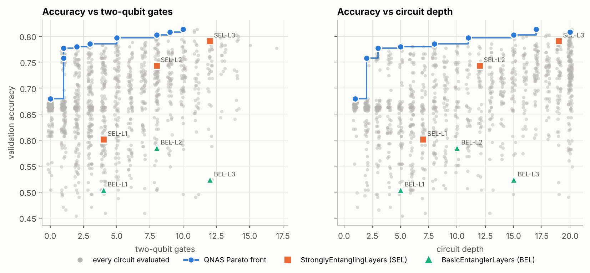
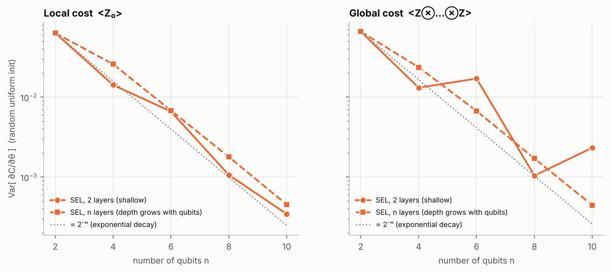
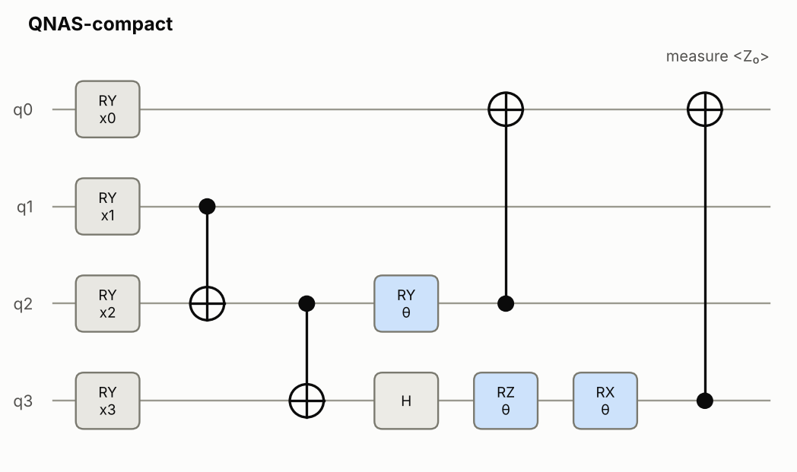

# QNAS(Quantum Neural Architecture Search) — Evolutionary Discovery of Efficient Quantum Circuits

**Author:** Swayam Shakya  ·  Python ≥ 3.10  ·  CPU only

QNAS uses a **genetic algorithm to design quantum circuits**. It decides which gates go on which
qubits in a variational quantum classifier. It looks for circuits that are accurate **and** cheap
to run on real hardware: shallow, with few two-qubit (entangling) gates. The evolved circuits are
then compared fairly with hand-made circuits, classical models, gradient (barren-plateau) behaviour
and simulated hardware noise.

Everything here runs in simulation on an ordinary laptop. No quantum computer or cloud account is
needed. All numbers below come from the real runs saved in [`runs/`](runs/).

<p align="center">
  
</p>

---

## The idea in one picture

```
 8x8 digit image ──► CNN autoencoder ──► 4 numbers ──► scaled to [0, π]
                                                         │
                      ┌──────────────── quantum circuit (4 qubits) ─────────────────┐
                      │  RY(x₀..x₃) encoding  ──►  EVOLVED gate sequence  ──►  ⟨Z₀⟩  │
                      └─────────────────────────────────────────────────────────────┘
                                                         │
                                 logit = scale · ⟨Z₀⟩ + bias  ──►  even or odd?
```

The classical part and the read-out stay fixed. **Only the gate sequence is searched.** A circuit is
written as a *genome*, a list of genes such as `RY(θ)[0] → CNOT[0,1] → RZ(θ)[1]`. The search then:

1. trains every candidate circuit for 5 epochs and scores it on a validation split;
2. keeps the circuits that are best on **three objectives at once** (NSGA-II): validation accuracy ↑,
   circuit depth ↓ and number of two-qubit gates ↓;
3. breeds new circuits by **crossover** (swapping sub-circuits) and **mutation** (changing, adding
   or deleting gates);
4. repeats for 40 generations, keeping every circuit it has ever scored in a Pareto archive.

Stack: **PennyLane** (circuits) · **PyTorch** (training through `qml.qnn.TorchLayer`) ·
**DEAP** (NSGA-II) · scikit-learn · matplotlib.

---

## Quick start 

```bash
git clone https://github.com/<your-username>/qnas.git
cd qnas
python -m venv .venv && source .venv/bin/activate      # Windows: .venv\Scripts\activate
pip install -r requirements.txt

python -m pytest -q                       # 35 tests, about 10 s
python -m qnas info                       # library versions and CPU count
python examples/01_hello_qubit.py         # one qubit by hand (instant)
python -m qnas demo --workers 2           # full pipeline, small budget: about 4 min -> runs/demo/results.md
```

To run the full experiment reported below (about 25 minutes on 2 cores):

```bash
python -m qnas run-all --preset standard --workers 2 --out runs/standard
```

`pip install -e .` also installs a `qnas` command, so you can write `qnas run-all ...`.

---

## What was done, step by step

| Stage | What happens | Output |
|---|---|---|
| **1. Data** | scikit-learn handwritten digits (1,797 images, 8×8). Even vs odd, split 60/20/20 with stratification: 1,078 train / 359 validation / 360 test. | `runs/*/task_info.json` |
| **2. Features** | A small convolutional autoencoder, trained **without labels on the training images only**, squeezes each image to 4 numbers. These are z-scored and mapped onto angles in [0, π]. | cached features |
| **3. Search** | NSGA-II over circuits with up to 48 gates and depth 20. Gates: RX, RY, RZ, H, CNOT, CZ, SWAP. Population 30 × 40 generations; P_c = 0.8, P_m = 0.2. Generation 0 holds the six hand-made templates plus 24 random circuits. | `search/pareto.json`, `history.csv`, `archive.json` |
| **4. Baselines** | PennyLane's StronglyEntanglingLayers (SEL) and BasicEntanglerLayers (BEL), 1–3 layers, written as genomes. They are checked to match PennyLane's own templates to 1e-8 and scored with the same protocol. | `baselines.json` |
| **5. Candidates** | Three circuits are taken from the front: **bestF** (best weighted fitness), **accurate** (best accuracy) and **compact** (fewest two-qubit gates within 2 points of the best). Each is simplified losslessly, then pruned by multi-seed gate ablation. The un-pruned `-full` versions are kept too. | `candidates.json` |
| **6. Final test** | **15 models × 5 seeds × 30 epochs**, trained from scratch and scored **once** on the untouched test split. Welch t-tests compare them. | `final/` |
| **7. Gradients** | A barren-plateau scan (2–10 qubits, local and global cost) and the gradient statistics of every 4-qubit circuit. | `gradients/` |
| **8. Noise** | The trained circuits are re-scored on a density-matrix simulator with depolarizing noise after every gate. Two-qubit gates get 10× the single-qubit rate. | `noise/` |
| **9. Report** | Every figure and a `results.md`, in which every sentence is computed from the saved files. | `results.md`, `figures/` |

The scalar fitness used for the "bestF" pick is

```
F(C) = α·accuracy − β·depth/D_max − γ·N_2q/N_max      with α = 1, β = 0.1, γ = 0.2, D_max = 20, N_max = 48
```

---

## Results

All numbers are from [`runs/standard`](runs/standard/results.md). The search trained
**1,176 distinct circuits in 544 s** and found a Pareto front of **9 circuits**. The whole pipeline
took 1,407 s on 2 CPU cores.

### Final test accuracy (5 seeds × 30 epochs, 360 unseen test images)

| Model | Test accuracy | Two-qubit gates | Depth | Parameters |
|---|---|---|---|---|
| SEL-L3 (hand-made) | 83.9% ± 0.9 | 12 | 19 | 38 |
| **QNAS-accurate-full (evolved)** | **83.6% ± 0.8** | **10** | **16** | 26 |
| SEL-L2 (hand-made) | 80.4% ± 1.3 | 8 | 12 | 26 |
| MLP, size of SEL-L2 (classical) | 79.9% ± 3.3 | – | – | 25 |
| MLP, size of QNAS-bestF (classical) | 79.0% ± 3.2 | – | – | 13 |
| **QNAS-compact (evolved, pruned)** | **77.1% ± 1.4** | **4** | **6** | **5** |
| QNAS-compact-full | 76.3% ± 2.0 | 5 | 11 | 16 |
| QNAS-accurate (pruned) | 73.9% ± 0.7 | 5 | 8 | 7 |
| **QNAS-bestF (evolved, pruned)** | **73.1% ± 0.6** | **1** | **2** | **3** |
| QNAS-bestF-full | 72.6% ± 1.8 | 1 | 3 | 8 |
| Linear / logistic regression | 67.9% ± 1.0 | – | – | 5 |
| SEL-L1 | 60.6% ± 4.8 | 4 | 7 | 14 |
| BEL-L2 / BEL-L3 / BEL-L1 | 55.6% / 50.4% / 48.3% | 8 / 12 / 4 | 10 / 15 / 5 | 10 / 14 / 6 |

<p align="center"></p>

### What the results show

- **The evolved circuit matches the best hand-made one with fewer entangling gates.** QNAS-accurate-full
  scores 83.6% against SEL-L3's 83.9%. The difference is −0.3 points (Welch p = 0.63, not significant).
  It uses 10 instead of 12 two-qubit gates and has depth 16 instead of 19.
- **A whole trade-off curve was found, not just one circuit.** With 4 two-qubit gates the evolved circuit
  reaches 77.1%. Even **one** CNOT and **one** trainable angle reach 73.1%, which beats logistic
  regression (67.9%). That one-gate circuit computes ⟨Z₀⟩ = cos(x₀)·cos(x₃ + θ): a product feature
  that a linear model cannot form.
- **Pruning is not free.** Gates that looked useless after 5 epochs mattered after 30. The pruned
  QNAS-accurate scores 73.9%; its un-pruned version scores 83.6%.
- **No quantum advantage is claimed.** Small classical MLPs of similar size reach 79–80%. This project
  studies architecture, hardware cost and trainability.

### Search progress and the Pareto front

<p align="center"></p>

During the search the hypervolume of the front grew from 0.632 to 0.746, and the best validation
accuracy rose from 79.1% to 81.3%. Under the same short protocol, all six hand-made templates are
dominated by at least one evolved circuit.

**Warm start vs cold start.** A second search was started from 30 purely random circuits
([`runs/cold_start`](runs/cold_start/)). It does not collapse: its best validation accuracy climbs
from 66.9% to 79.1% (front of 6, hypervolume 0.734). The template warm start still gives the
better front (81.3%, hypervolume 0.746).

### Barren plateaus (trainability)

<p align="center"></p>

The variance of the gradient falls roughly **2× for every added qubit** (log₂ slope −0.67 to −0.94),
as McClean et al. (2018) predict. At 4 qubits the effect is mild and does not stop training. The small
evolved circuits keep larger gradients per parameter than the deep templates.

### Robustness to hardware noise

| Circuit | p = 0 | p = 0.001 | p = 0.003 | p = 0.01 | p = 0.03 |
|---|---|---|---|---|---|
| QNAS-bestF (1 two-qubit gate) | 68.7% | 68.7% | 69.3% | 70.0% | **69.3%** |
| QNAS-compact (4) | 70.0% | 69.3% | 70.7% | 71.3% | **62.7%** |
| QNAS-accurate (5) | 72.0% | 72.0% | 72.7% | 70.7% | **62.7%** |
| SEL-L2 (8) | 78.7% | 78.0% | 78.7% | 78.7% | **49.3%** |
| BEL-L2 (8) | 58.0% | 58.0% | 58.7% | 53.3% | 50.7% |

*p* is the single-qubit depolarizing rate; two-qubit gates get 10 × *p*. The scores are measured on
150 test images, and the circuits were trained without noise. At 3% noise the hand-made SEL-L2 falls
to chance. The small evolved circuits keep 63–69%.

### A discovered circuit

<p align="center"></p>

`QNAS-compact`: 8 gates, 4 CNOTs, depth 6, 3 trainable angles, 77.1% test accuracy.
Column 0 is the fixed RY(xᵢ) encoding.

---

## Demo walkthrough

**a) One qubit, checked against pen and paper** (`examples/01_hello_qubit.py`)

```text
<Z>            = 0.704466   (cos(x)cos(theta) = 0.704466)
d<Z>/d theta   = -0.297844   (-cos(x)sin(theta)  = -0.297844)
0: ──RY(0.70)──RX(0.40)─┤  <Z>
```

**b) A circuit is a list of genes** (`examples/02_build_a_genome.py`)

```text
genome        : RY(θ)[0] → RY(θ)[1] → CNOT[0,1] → RZ(θ)[1] → CNOT[1,2] → RX(θ)[2]
depth         : 5
two-qubit gates: 2
child (crossover): CNOT[0,1] → RZ(θ)[1] → CNOT[1,2] → RX(θ)[2]
mutant        : CZ[2,3] → RZ(θ)[1] → RZ(-π/2)[0] → RY(θ)[3]
all legal     : True
```

**c) Train one hybrid classifier** (`examples/03_hybrid_classifier.py`, about 10 s): a 2-layer SEL
circuit on PCA features reaches 81.4% test accuracy.

**d) A tiny search** (`examples/04_tiny_search.py`, about 30 s): 12 circuits × 6 generations,
printing the Pareto front.

**e) The whole pipeline on a small budget**

```bash
python -m qnas demo --workers 2
```

```text
gen   0/6 | evals   10 (+10 ) | best acc 0.783 | best F 0.673 | ...
...
done in 237s -> runs/demo/results.md
```

Open `runs/demo/results.md` to see the generated report, with tables, p-values and figures.

---

## Command-line reference

```
python -m qnas <command> [options]
  demo | run-all | search | baselines | candidates | final | gradients | noise | report | info
```

| Option | Meaning |
|---|---|
| `--preset quick\|standard\|thorough` | budget (about 4 min / 25 min / a few hours on 2 cores) |
| `--dataset digits\|breast_cancer\|pneumoniamnist\|breastmnist` | data (`digits` and `breast_cancer` work offline) |
| `--task even-odd\|low-high\|3v5\|0v1`, `--classes 3 5` | which binary digit task |
| `--extractor cnn\|pca` | classical front end |
| `--qubits N` | number of qubits = number of features (default 4) |
| `--mode nsga2\|weighted` | multi-objective NSGA-II (default) or weighted-fitness GA |
| `--objectives acc depth n2q params` | objectives for NSGA-II |
| `--pop`, `--generations`, `--epochs` | population, generations, training epochs per candidate |
| `--cold-start` | start from random circuits only |
| `--connectivity all\|linear\|ring` | allowed two-qubit wiring |
| `--data-reuploading` | allow rotations whose angle is an input feature |
| `--no-prune`, `--no-noise` | skip pruning / the noise study |
| `--workers N` | parallel processes |
| `--resume` | continue an interrupted search from its checkpoint |

Stages can be run one at a time on an existing run folder, for example
`python -m qnas final --out runs/standard`.

**Using the medical dataset (PneumoniaMNIST).** Download `pneumoniamnist.npz` from
<https://medmnist.com> into `data/`, or `pip install medmnist`, which downloads it for you. Then run:

```bash
python -m qnas run-all --dataset pneumoniamnist --out runs/pneumonia --workers 2
```

---

## Reproducibility and testing

- **Deterministic scores.** Each circuit's training seed is derived from a SHA-1 hash of its genome.
  The same circuit therefore always gets the same score, in any worker process, in any order.
- **Verified re-run.** Version 1.1.0 was re-run from an empty folder. It reproduced every number of
  the earlier run exactly: the same 1,176 circuits, the same front and the same 15 test accuracies.
- **Leak-free evaluation.** The feature extractor is fitted on training images only. The search sees
  only train and validation data. The test split is used once, in the final comparison.
- **Checkpoints.** A checkpoint is written after every generation; `--resume` continues from it.
- **Tests.** There are 35 tests: template equivalence with PennyLane (to 1e-8), legality of every
  genetic operator, exact hypervolume values, lossless simplification, deterministic evaluation,
  the barren-plateau trend, noise at p = 0 equal to the ideal result, search plus resume, and the CLI.

```bash
python -m pytest -q
```

---

## Limitations

- The planned medical dataset (PneumoniaMNIST) could not be downloaded on the machine used for these
  runs, so all results use the digits dataset. The loader is implemented and tested on a synthetic file.
- There is one search seed and five final seeds. Differences of 1–2 points are within noise; read the p-values.
- The `-full` (un-pruned) variants were added after the pruned results had been seen.
- Four qubits is a small scale. Barren-plateau and noise conclusions are trends, not hardware results.
- Small classical networks are competitive, so this is not a demonstration of quantum advantage.

---

## Citing and license

If you use this code, please cite it (see [`CITATION.cff`](CITATION.cff)):

> Shakya, S. (2026). *QNAS: Evolutionary Discovery of Efficient Quantum Circuits* [Computer Software].

Released under the [MIT License](LICENSE). Changes are listed in [`CHANGELOG.md`](CHANGELOG.md).
