# QNAS results - `demo`

*QNAS project by Swayam Shakya. Every number below is read from the files of this run.*

## Setup

- **Task:** digits [[0, 2, 4, 6, 8], [1, 3, 5, 7, 9]] (binary), classical extractor `cnn` -> 4 features -> 4 qubits
- **Split sizes:** train 1078, validation 359, test 360 (the search only ever sees train + validation; the test split is used once, in the final comparison)
- **Search:** `nsga2` | population 10 | 6 generations | P_c=0.8, P_m=0.2 per gene | objectives ['acc', 'depth', 'n2q'] | 3 training epochs per candidate | 67 unique circuits trained in 28s
- **Search space:** gates RX/RY/RZ/H/CNOT/CZ/SWAP, connectivity `all`, depth <= 20, <= 48 gates, data re-uploading off
- **Final protocol:** every model re-trained from scratch for 12 epochs x 2 seeds; fitness weights alpha=1.0, beta=0.1, gamma=0.2

## Headline: final test accuracy

| Model | Test accuracy (mean ± std) | Two-qubit gates | Depth | Parameters |
|---|---|---|---|---|
| SEL-L3 | 80.7% ± 2.9% | 12 | 19 | 38 |
| QNAS-accurate-full | 78.8% ± 1.8% | 10 | 20 | 35 |
| QNAS-compact-full | 78.8% ± 1.8% | 10 | 20 | 35 |
| QNAS-bestF-full | 78.2% ± 2.2% | 8 | 12 | 26 |
| SEL-L2 | 78.2% ± 2.2% | 8 | 12 | 26 |
| MLP-matched | 76.0% ± 0.6% | — | — | 13 |
| MLP-SEL2 | 75.8% ± 0.0% | — | — | 25 |
| QNAS-bestF | 74.0% ± 0.6% | 1 | 2 | 3 |
| QNAS-accurate | 73.9% ± 2.0% | 2 | 8 | 20 |
| QNAS-compact | 73.9% ± 2.0% | 2 | 8 | 20 |
| Linear | 68.6% ± 0.8% | — | — | 5 |
| SEL-L1 | 61.8% ± 0.2% | 4 | 7 | 14 |
| BEL-L2 | 60.0% ± 0.8% | 8 | 10 | 10 |
| BEL-L1 | 53.8% ± 0.6% | 4 | 5 | 6 |
| BEL-L3 | 53.2% ± 1.0% | 12 | 15 | 14 |

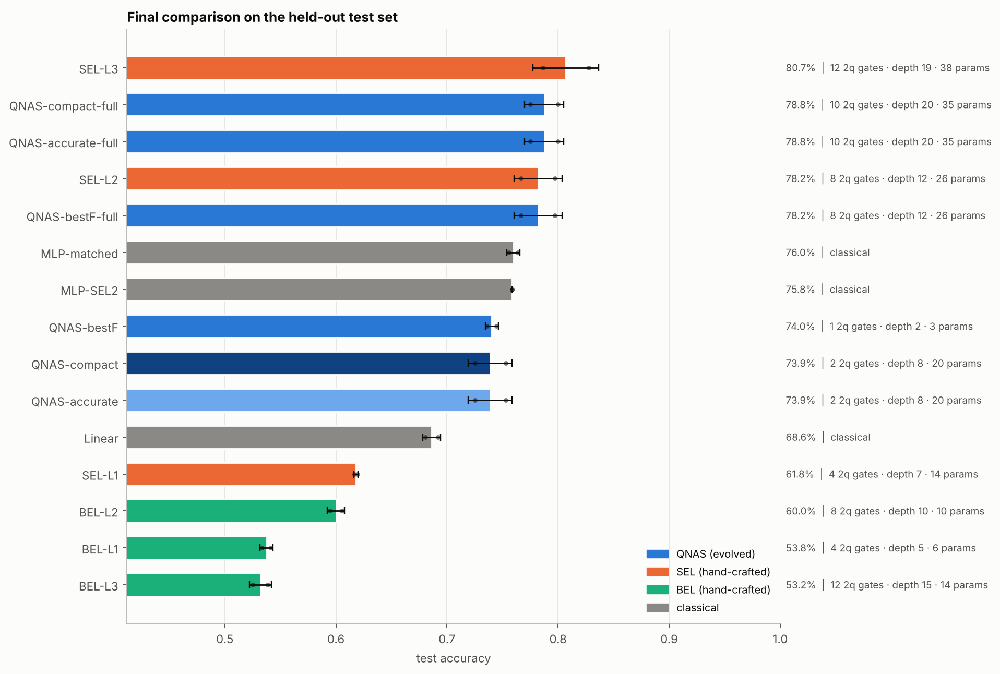

## RQ1 - Accuracy and efficiency

*Can evolved circuits match the hand-crafted templates with fewer two-qubit gates?*

| Evolved circuit | vs baseline | Δ accuracy | Welch p | Verdict | 2-qubit gates (evolved / baseline) | Depth (evolved / baseline) |
|---|---|---|---|---|---|---|
| QNAS-bestF | SEL-L1 | +12.2 pts | 0.01 | significantly higher | 1 / 4 | 2 / 7 |
| QNAS-bestF | SEL-L2 | -4.2 pts | 0.20 | lower (n.s.) | 1 / 8 | 2 / 12 |
| QNAS-bestF | SEL-L3 | -6.7 pts | 0.18 | lower (n.s.) | 1 / 12 | 2 / 19 |
| QNAS-bestF | BEL-L2 | +14.0 pts | <0.01 | significantly higher | 1 / 8 | 2 / 10 |
| QNAS-accurate | SEL-L1 | +12.1 pts | 0.07 | higher (n.s.) | 2 / 4 | 8 / 7 |
| QNAS-accurate | SEL-L2 | -4.3 pts | 0.17 | lower (n.s.) | 2 / 8 | 8 / 12 |
| QNAS-accurate | SEL-L3 | -6.8 pts | 0.13 | lower (n.s.) | 2 / 12 | 8 / 19 |
| QNAS-accurate | BEL-L2 | +13.9 pts | 0.04 | significantly higher | 2 / 8 | 8 / 10 |
| QNAS-compact | SEL-L1 | +12.1 pts | 0.07 | higher (n.s.) | 2 / 4 | 8 / 7 |
| QNAS-compact | SEL-L2 | -4.3 pts | 0.17 | lower (n.s.) | 2 / 8 | 8 / 12 |
| QNAS-compact | SEL-L3 | -6.8 pts | 0.13 | lower (n.s.) | 2 / 12 | 8 / 19 |
| QNAS-compact | BEL-L2 | +13.9 pts | 0.04 | significantly higher | 2 / 8 | 8 / 10 |
| QNAS-bestF-full | SEL-L1 | +16.4 pts | 0.06 | higher (n.s.) | 8 / 4 | 12 / 7 |
| QNAS-bestF-full | SEL-L2 | +0.0 pts | 1.00 | no significant difference | 8 / 8 | 12 / 12 |
| QNAS-bestF-full | SEL-L3 | -2.5 pts | 0.44 | no significant difference | 8 / 12 | 12 / 19 |
| QNAS-bestF-full | BEL-L2 | +18.2 pts | 0.03 | significantly higher | 8 / 8 | 12 / 10 |
| QNAS-accurate-full | SEL-L1 | +16.9 pts | 0.04 | significantly higher | 10 / 4 | 20 / 7 |
| QNAS-accurate-full | SEL-L2 | +0.6 pts | 0.81 | no significant difference | 10 / 8 | 20 / 12 |
| QNAS-accurate-full | SEL-L3 | -1.9 pts | 0.52 | no significant difference | 10 / 12 | 20 / 19 |
| QNAS-accurate-full | BEL-L2 | +18.8 pts | 0.02 | significantly higher | 10 / 8 | 20 / 10 |
| QNAS-compact-full | SEL-L1 | +16.9 pts | 0.04 | significantly higher | 10 / 4 | 20 / 7 |
| QNAS-compact-full | SEL-L2 | +0.6 pts | 0.81 | no significant difference | 10 / 8 | 20 / 12 |
| QNAS-compact-full | SEL-L3 | -1.9 pts | 0.52 | no significant difference | 10 / 12 | 20 / 19 |
| QNAS-compact-full | BEL-L2 | +18.8 pts | 0.02 | significantly higher | 10 / 8 | 20 / 10 |

- Best hand-crafted baseline: **SEL-L3** at 80.7% (12 two-qubit gates, depth 19).
- Best evolved circuit: **QNAS-accurate-full** at 78.8% (10 two-qubit gates, depth 20).
- Cheapest evolved circuit within 2 points of (or above) that baseline: **QNAS-accurate-full** - 10 vs 12 two-qubit gates (17% fewer) and depth 20 vs 19.
- Classical `Linear`: 68.6% (5 parameters).
- Classical `MLP-matched`: 76.0% (13 parameters).
- Classical `MLP-SEL2`: 75.8% (25 parameters).

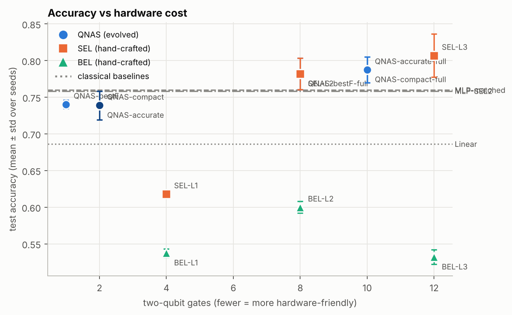

## RQ2 - Multi-objective trade-offs (Pareto front)

- Pareto front over **all 67 circuits evaluated**: 11 non-dominated circuits (objectives: acc, depth, n2q).
- Hypervolume of the front grew from 0.5590 (generation 0) to 0.6778 (generation 6); best validation accuracy 78.3% -> 81.1%.
- 4 of 6 hand-crafted baselines are *dominated* by at least one evolved circuit (same short training protocol; validation accuracy, depth, two-qubit gates): SEL-L1, BEL-L1, BEL-L2, BEL-L3.

| Val. acc | Depth | 2-qubit | Params | F(C) | Circuit |
|---|---|---|---|---|---|
| 81.1% | 20 | 10 | 36 | 0.669 | `RY(θ)[1] → RY(θ)[0] → RZ(θ)[0] → CNOT[1,2] → CNOT[2,3] → CNOT[3,0] → RZ(θ)[0] → RY(θ)[0] → RZ(θ)[0] → RZ(θ)[1] → RY(θ)[1] → RZ(θ)[1] → RZ(θ)[2] → RY(θ)[2] → RZ(θ)[2] → RZ(θ)[3] → RY(θ)[3] → RZ(θ)[3] → CZ[2,3] → RY(θ)[1] → CNOT[2,0] → CNOT[1,3] → RZ(θ)[0] → RY(θ)[0] → RZ(θ)[0] → CNOT[1,0] → RY(θ)[1] → RZ(θ)[1] → RZ(θ)[2] → CNOT[3,1] → RZ(θ)[0] → RY(θ)[0] → RZ(θ)[0] → RZ(θ)[1] → RY(θ)[1] → RZ(θ)[1] → RZ(θ)[2] → RY(θ)[2] → RZ(θ)[2] → RZ(θ)[3] → RY(θ)[3] → RZ(θ)[3] → CNOT[2,0] → CNOT[1,0]` |
| 78.3% | 19 | 12 | 38 | 0.638 | `RZ(θ)[0] → RY(θ)[0] → RZ(θ)[0] → RZ(θ)[1] → RY(θ)[1] → RZ(θ)[1] → RZ(θ)[2] → RY(θ)[2] → RZ(θ)[2] → RZ(θ)[3] → RY(θ)[3] → RZ(θ)[3] → CNOT[0,1] → CNOT[1,2] → CNOT[2,3] → CNOT[3,0] → RZ(θ)[0] → RY(θ)[0] → RZ(θ)[0] → RZ(θ)[1] → RY(θ)[1] → RZ(θ)[1] → RZ(θ)[2] → RY(θ)[2] → RZ(θ)[2] → RZ(θ)[3] → RY(θ)[3] → RZ(θ)[3] → CNOT[0,2] → CNOT[1,3] → CNOT[2,0] → CNOT[3,1] → RZ(θ)[0] → RY(θ)[0] → RZ(θ)[0] → RZ(θ)[1] → RY(θ)[1] → RZ(θ)[1] → RZ(θ)[2] → RY(θ)[2] → RZ(θ)[2] → RZ(θ)[3] → RY(θ)[3] → RZ(θ)[3] → CNOT[0,3] → CNOT[1,0] → CNOT[2,1] → CNOT[3,2]` |
| 78.0% | 16 | 9 | 23 | 0.662 | `RY(θ)[1] → RY(θ)[0] → RZ(θ)[0] → CNOT[0,1] → CNOT[2,3] → RY(θ)[1] → RX(θ)[3] → RZ(θ)[1] → RY(θ)[2] → RZ(θ)[2] → RZ(π/2)[3] → RY(θ)[3] → RZ(θ)[3] → CNOT[0,1] → RZ(θ)[2] → CNOT[2,3] → CNOT[3,0] → RZ(θ)[0] → RY(θ)[0] → RZ(θ)[0] → CNOT[1,3] → RZ(θ)[2] → RY(θ)[0] → RZ(θ)[0] → CNOT[1,0] → CNOT[0,3] → RZ(-π/4)[1] → RZ(θ)[2] → CNOT[3,1] → RY(θ)[0] → RZ(θ)[0] → RZ(θ)[1]` |
| 77.7% | 20 | 8 | 35 | 0.644 | `RY(θ)[1] → RY(θ)[0] → RZ(θ)[0] → CNOT[1,2] → CNOT[2,3] → CNOT[3,0] → RZ(θ)[0] → RY(θ)[0] → RZ(θ)[0] → RZ(θ)[1] → RY(θ)[1] → RZ(θ)[0] → RZ(θ)[2] → RY(θ)[2] → RZ(θ)[2] → RZ(θ)[3] → RY(θ)[3] → RY(θ)[0] → CZ[2,3] → RY(θ)[2] → CNOT[2,0] → CNOT[1,3] → RZ(θ)[0] → RY(θ)[0] → RZ(θ)[0] → CNOT[1,0] → RY(θ)[1] → RZ(-π/4)[1] → RZ(θ)[2] → CNOT[3,1] → RZ(θ)[0] → RY(θ)[0] → RZ(θ)[0] → RZ(θ)[1] → RY(θ)[1] → RZ(θ)[1] → RZ(θ)[2] → RY(θ)[2] → RZ(θ)[2] → RZ(θ)[3] → RY(θ)[3] → RZ(θ)[3]` |
| 76.6% | 12 | 8 | 26 | 0.673 | `RZ(θ)[0] → RY(θ)[0] → RZ(θ)[0] → RZ(θ)[1] → RY(θ)[1] → RZ(θ)[1] → RZ(θ)[2] → RY(θ)[2] → RZ(θ)[2] → RZ(θ)[3] → RY(θ)[3] → RZ(θ)[3] → CNOT[0,1] → CNOT[1,2] → CNOT[2,3] → CNOT[3,0] → RZ(θ)[0] → RY(θ)[0] → RZ(θ)[0] → RZ(θ)[1] → RY(θ)[1] → RZ(θ)[1] → RZ(θ)[2] → RY(θ)[2] → RZ(θ)[2] → RZ(θ)[3] → RY(θ)[3] → RZ(θ)[3] → CNOT[0,2] → CNOT[1,3] → CNOT[2,0] → CNOT[3,1]` |
| 71.6% | 16 | 7 | 24 | 0.607 | `RY(θ)[1] → RY(θ)[0] → RZ(θ)[0] → CNOT[0,1] → CNOT[2,3] → RY(θ)[1] → RX(θ)[3] → RZ(θ)[1] → RY(θ)[2] → RZ(θ)[2] → RZ(π/2)[3] → RY(θ)[3] → SWAP[0,2] → RZ(θ)[1] → CNOT[0,1] → RZ(θ)[3] → CNOT[3,0] → RZ(θ)[0] → RY(θ)[0] → RZ(θ)[0] → CNOT[3,2] → RZ(θ)[3] → RY(θ)[0] → RZ(θ)[0] → RY(θ)[2] → RZ(-π/4)[1] → CZ[1,3] → RY(θ)[0] → RZ(θ)[0] → RZ(θ)[0] → RZ(θ)[1]` |
| 70.8% | 11 | 7 | 21 | 0.623 | `RY(θ)[3] → RY(θ)[0] → RZ(θ)[0] → CNOT[1,2] → CNOT[2,3] → CNOT[3,0] → RZ(θ)[0] → RZ(θ)[2] → RY(θ)[0] → RY(θ)[0] → RZ(θ)[0] → RZ(θ)[1] → RY(θ)[1] → RZ(θ)[1] → RZ(θ)[2] → RY(θ)[2] → RZ(θ)[2] → RZ(θ)[3] → RY(θ)[3] → RZ(θ)[3] → CNOT[0,1] → CNOT[1,2] → RY(θ)[1] → RZ(θ)[3] → CNOT[2,0] → CNOT[2,1]` |
| 69.9% | 15 | 6 | 24 | 0.599 | `RY(θ)[1] → RY(θ)[0] → RZ(θ)[0] → CNOT[0,1] → CNOT[2,3] → RY(θ)[1] → RX(θ)[3] → RZ(θ)[1] → RY(θ)[2] → RZ(θ)[2] → RZ(π/2)[3] → RY(θ)[3] → RZ(θ)[3] → CNOT[0,1] → RZ(θ)[3] → CNOT[3,0] → RZ(θ)[0] → RY(θ)[0] → RZ(θ)[0] → CNOT[1,3] → RZ(θ)[2] → RY(θ)[0] → RZ(θ)[0] → RY(θ)[2] → RZ(-π/4)[1] → CZ[1,3] → RY(θ)[0] → RY(θ)[0] → RZ(θ)[0] → RZ(θ)[1]` |
| 69.6% | 9 | 5 | 15 | 0.631 | `RY(θ)[3] → RY(θ)[0] → RZ(θ)[0] → CNOT[1,2] → CNOT[2,3] → CNOT[3,0] → RZ(θ)[0] → RZ(θ)[2] → RY(θ)[2] → RX(θ)[0] → RZ(θ)[2] → RY(θ)[2] → RZ(θ)[2] → RZ(θ)[3] → RY(θ)[3] → RZ(θ)[3] → CNOT[2,0] → CNOT[1,0]` |
| 66.3% | 2 | 0 | 5 | 0.653 | `RY(θ)[2] → RZ(θ)[2] → RZ(θ)[3]` |
| 65.7% | 1 | 0 | 5 | 0.652 | `RY(θ)[1] → RZ(θ)[2] → RZ(θ)[3]` |

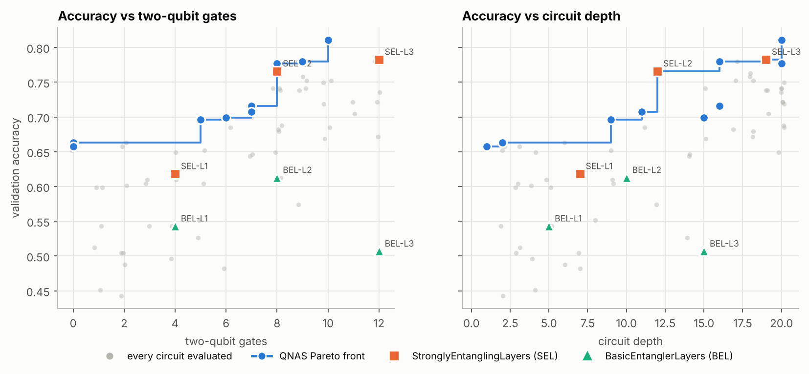

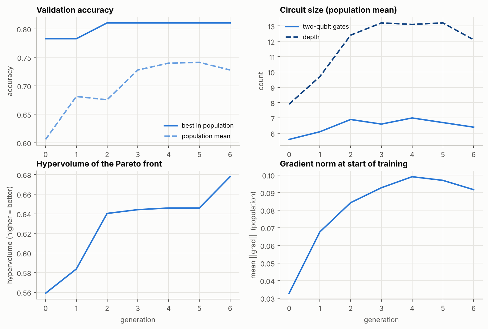

## RQ3 - Trainability and gradients

**Barren-plateau scan** (template circuits, random uniform initialisation): the slope is the change of log₂ Var[∂C/∂θ] per added qubit (−1 = variance halves with every qubit).

| Template | Cost | Var at smallest n | Var at largest n | log₂-slope per qubit |
|---|---|---|---|---|
| SEL, 2 layers (shallow) | local ⟨Z₀⟩ | 6.13e-02 (n=2) | 7.77e-03 (n=6) | -0.74 |
| SEL, 2 layers (shallow) | global ⟨Z⊗…⊗Z⟩ | 6.06e-02 (n=2) | 1.58e-02 (n=6) | -0.48 |
| SEL, n layers (depth grows with qubits) | local ⟨Z₀⟩ | 6.13e-02 (n=2) | 7.00e-03 (n=6) | -0.78 |
| SEL, n layers (depth grows with qubits) | global ⟨Z⊗…⊗Z⟩ | 6.06e-02 (n=2) | 6.12e-03 (n=6) | -0.83 |

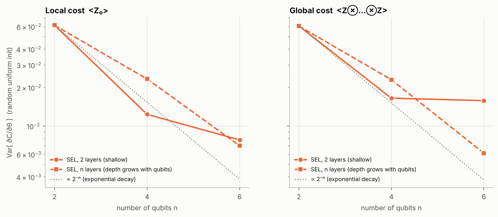

**Gradients of concrete 4-qubit circuits** (mean over parameters of Var[∂⟨Z₀⟩/∂θ] across 100+ random initialisations; `frac small` = share of gradient entries below 1e-3):

| Circuit | Init | Parameters | Mean Var | Mean abs grad | frac small |
|---|---|---|---|---|---|
| QNAS-bestF | uniform | 1 | 1.01e-01 | 2.33e-01 | 0.00 |
| QNAS-bestF | small | 1 | 1.54e-01 | 3.28e-01 | 0.00 |
| QNAS-accurate | uniform | 18 | 3.54e-02 | 8.75e-02 | 0.62 |
| QNAS-accurate | small | 18 | 2.24e-02 | 8.75e-02 | 0.63 |
| QNAS-compact | uniform | 18 | 3.54e-02 | 8.75e-02 | 0.62 |
| QNAS-compact | small | 18 | 2.24e-02 | 8.75e-02 | 0.63 |
| SEL-L1 | uniform | 12 | 1.24e-02 | 4.90e-02 | 0.53 |
| SEL-L1 | small | 12 | 1.01e-02 | 3.84e-02 | 0.59 |
| SEL-L2 | uniform | 24 | 1.38e-02 | 5.18e-02 | 0.53 |
| SEL-L2 | small | 24 | 8.77e-03 | 5.38e-02 | 0.54 |
| SEL-L3 | uniform | 36 | 2.23e-02 | 9.26e-02 | 0.23 |
| SEL-L3 | small | 36 | 1.00e-02 | 6.57e-02 | 0.25 |
| BEL-L2 | uniform | 8 | 5.27e-04 | 1.08e-02 | 0.38 |
| BEL-L2 | small | 8 | 4.48e-04 | 9.44e-03 | 0.41 |

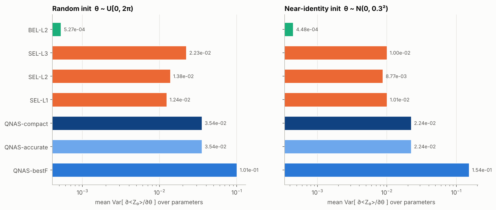

**Gradient flow during training** (mean gradient norm over the circuit angles, averaged over seeds):

| Model | epoch 1 | last epoch | ratio last/first |
|---|---|---|---|
| QNAS-bestF | 7.953e-02 | 7.071e-02 | 0.89 |
| QNAS-compact | 1.777e-01 | 3.394e-01 | 1.91 |
| QNAS-accurate | 1.777e-01 | 3.394e-01 | 1.91 |
| SEL-L1 | 7.240e-02 | 9.493e-02 | 1.31 |
| SEL-L2 | 1.209e-01 | 2.994e-01 | 2.48 |
| SEL-L3 | 1.512e-01 | 5.165e-01 | 3.42 |
| BEL-L2 | 8.378e-03 | 8.363e-03 | 1.00 |

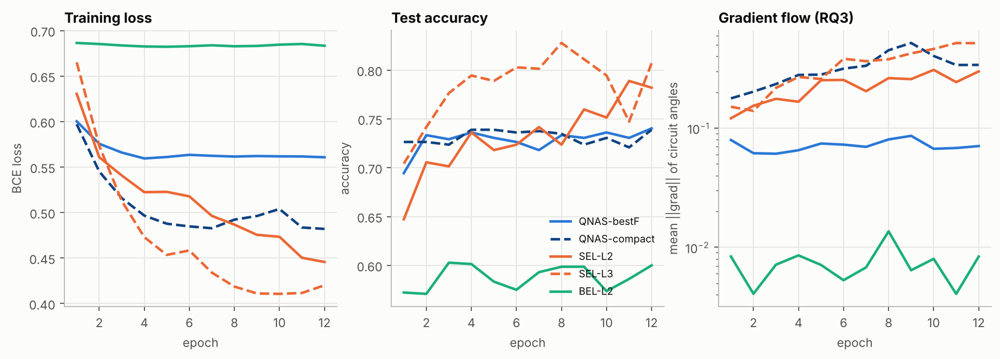

Population-mean gradient norm during the search went from 3.283e-02 (generation 0) to 9.171e-02 (generation 6).

> **Reading this honestly:** with only 4 qubits a barren plateau cannot yet bite hard - the scan above shows the *trend* with qubit count on templates; the per-circuit table shows that evolved circuits, being shorter, usually keep gradients of comparable or larger size per parameter than the deep templates. To test scaling, re-run the search with `--qubits 6` or `--qubits 8`.

## Robustness to hardware noise (optional extension)

Circuits were trained noise-free, then evaluated on `default.mixed` with depolarizing noise after every gate (two-qubit gates 10x noisier). Test accuracy:

| Circuit | p=0 | p=0.001 | p=0.003 | p=0.01 | p=0.03 |
|---|---|---|---|---|---|
| QNAS-bestF | 71.3% | 71.3% | 71.3% | 72.0% | 72.7% |
| QNAS-accurate | 74.0% | 74.0% | 73.3% | 72.7% | 71.3% |
| QNAS-compact | 74.0% | 74.0% | 73.3% | 72.7% | 71.3% |
| SEL-L2 | 76.7% | 76.7% | 76.0% | 76.7% | 52.0% |
| BEL-L2 | 60.0% | 60.7% | 59.3% | 62.0% | 50.7% |

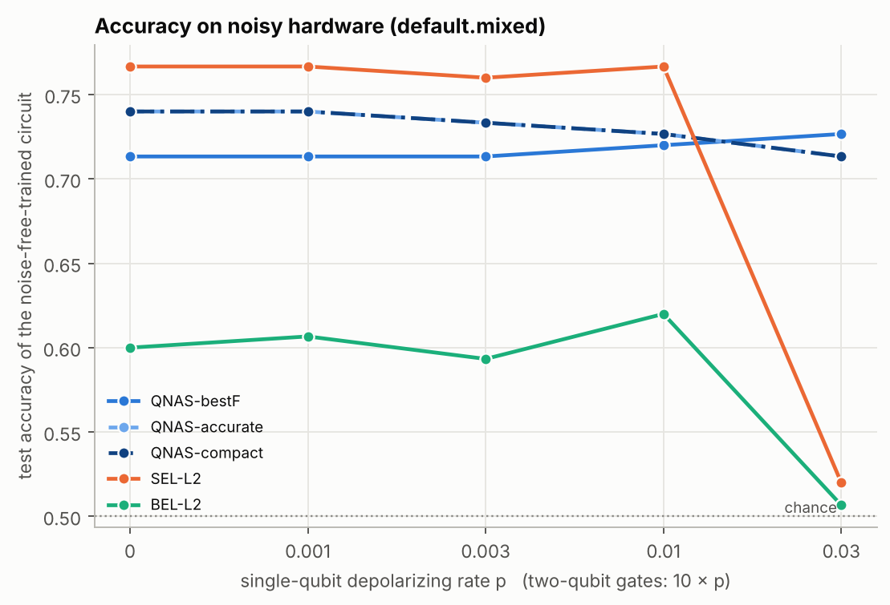

## Discovered circuits

Column 0 is the fixed `RY(xᵢ)` data encoding; blue boxes are trainable angles θ; the circuit returns ⟨Z₀⟩.

### QNAS-bestF

- Found by search: 32 gates, 8 two-qubit, depth 12. After lossless simplification + ablation pruning: 2 gates, 1 two-qubit, depth 2, 1 trainable angles.
- `RY(θ)[3] → CNOT[3,0]`

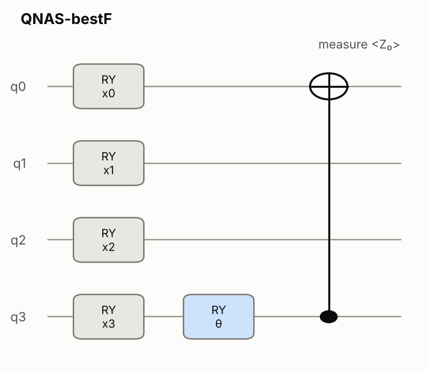

### QNAS-accurate

- Found by search: 44 gates, 10 two-qubit, depth 20. After lossless simplification + ablation pruning: 20 gates, 2 two-qubit, depth 8, 18 trainable angles.
- `RY(θ)[1] → RZ(θ)[0] → CNOT[2,3] → RY(θ)[0] → RZ(θ)[0] → RZ(θ)[1] → RY(θ)[1] → RZ(θ)[1] → RZ(θ)[2] → RY(θ)[2] → RZ(θ)[2] → RY(θ)[3] → RY(θ)[1] → CNOT[2,0] → RZ(θ)[0] → RY(θ)[0] → RZ(θ)[2] → RZ(θ)[0] → RY(θ)[2] → RZ(θ)[3]`

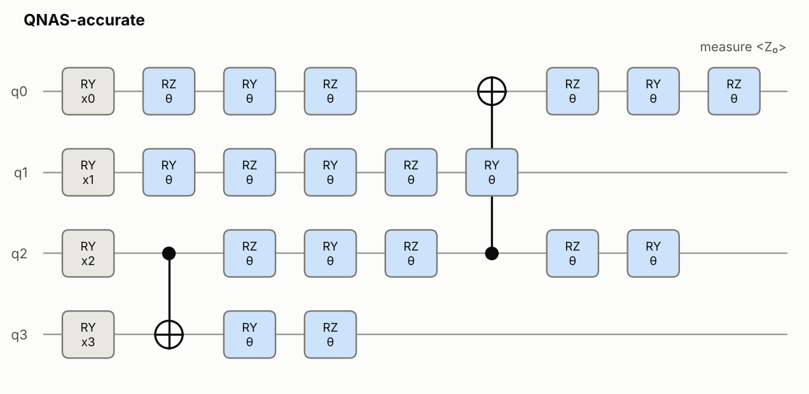

### QNAS-compact

- Found by search: 44 gates, 10 two-qubit, depth 20. After lossless simplification + ablation pruning: 20 gates, 2 two-qubit, depth 8, 18 trainable angles.
- `RY(θ)[1] → RZ(θ)[0] → CNOT[2,3] → RY(θ)[0] → RZ(θ)[0] → RZ(θ)[1] → RY(θ)[1] → RZ(θ)[1] → RZ(θ)[2] → RY(θ)[2] → RZ(θ)[2] → RY(θ)[3] → RY(θ)[1] → CNOT[2,0] → RZ(θ)[0] → RY(θ)[0] → RZ(θ)[2] → RZ(θ)[0] → RY(θ)[2] → RZ(θ)[3]`

For reference, the hand-crafted `SEL-L2`:

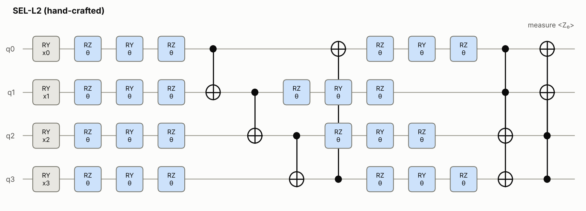

## Caveats

- Accuracy differences of 1–2 points are within seed-to-seed noise on datasets this small; read the *p* values.
- The search selects on validation accuracy from a short training run (winner's curse); that is why the final stage re-trains everything on fresh seeds and reports the untouched test split.
- Everything is exact state-vector simulation of a few qubits: conclusions about *hardware* come only from the proxy metrics (depth, two-qubit gates) and the depolarizing-noise study.
- Baselines are evaluated with the same fixed RY(x) encoding and ⟨Z₀⟩ read-out as the evolved circuits.

## Files

- `config.json`
- `task_info.json`
- `search/history.csv`
- `search/pareto.json`
- `search/archive.json`
- `baselines.json`
- `candidates.json`
- `final/final_summary.csv`
- `final/final_runs.json`
- `gradients/gradients.json`
- `noise/noise.json`
- `log.txt`
