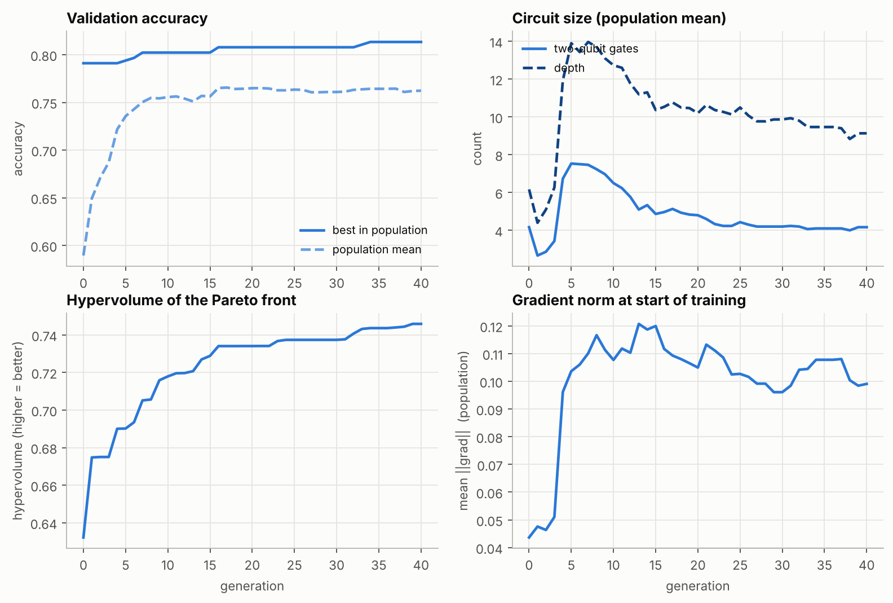
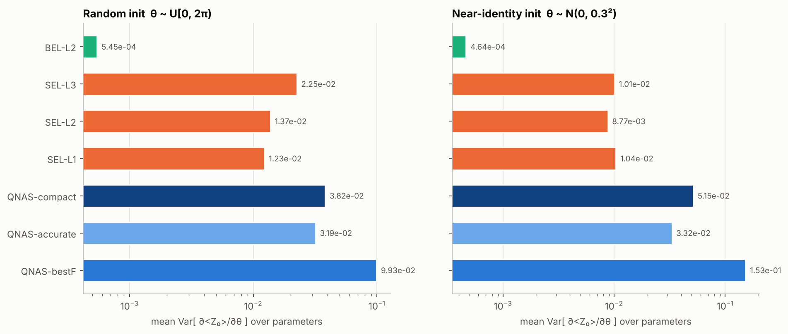
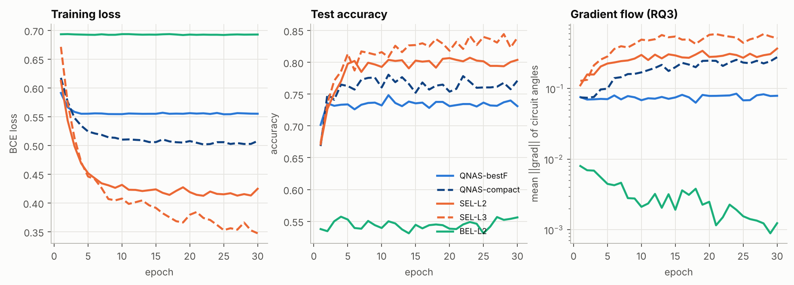
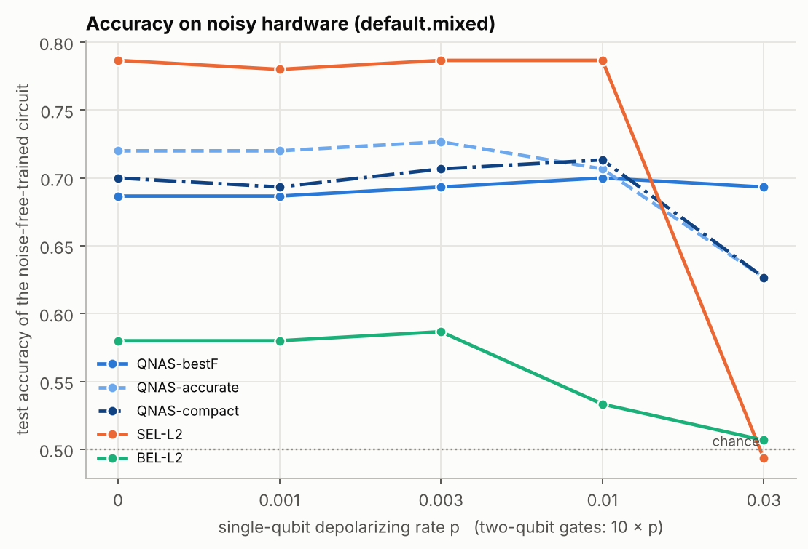
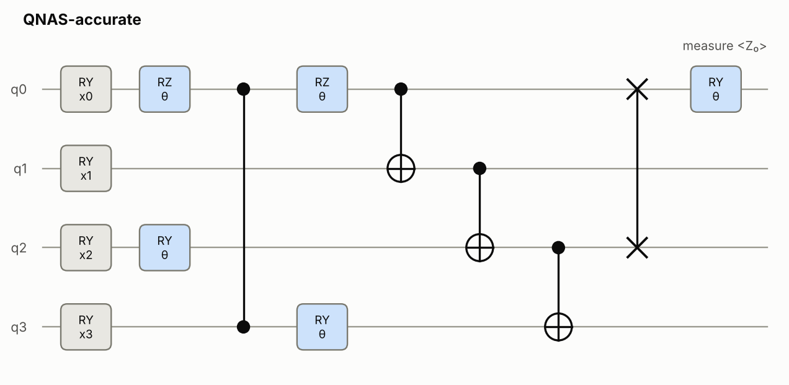

# QNAS results - `standard`

*QNAS project by Swayam Shakya. Every number below is read from the files of this run.*

## Setup

- **Task:** digits [[0, 2, 4, 6, 8], [1, 3, 5, 7, 9]] (binary), classical extractor `cnn` -> 4 features -> 4 qubits
- **Split sizes:** train 1078, validation 359, test 360 (the search only ever sees train + validation; the test split is used once, in the final comparison)
- **Search:** `nsga2` | population 30 | 40 generations | P_c=0.8, P_m=0.2 per gene | objectives ['acc', 'depth', 'n2q'] | 5 training epochs per candidate | 1176 unique circuits trained in 544s
- **Search space:** gates RX/RY/RZ/H/CNOT/CZ/SWAP, connectivity `all`, depth <= 20, <= 48 gates, data re-uploading off
- **Final protocol:** every model re-trained from scratch for 30 epochs x 5 seeds; fitness weights alpha=1.0, beta=0.1, gamma=0.2

## Headline: final test accuracy

| Model | Test accuracy (mean ± std) | Two-qubit gates | Depth | Parameters |
|---|---|---|---|---|
| SEL-L3 | 83.9% ± 0.9% | 12 | 19 | 38 |
| QNAS-accurate-full | 83.6% ± 0.8% | 10 | 16 | 26 |
| SEL-L2 | 80.4% ± 1.3% | 8 | 12 | 26 |
| MLP-SEL2 | 79.9% ± 3.3% | — | — | 25 |
| MLP-matched | 79.0% ± 3.2% | — | — | 13 |
| QNAS-compact | 77.1% ± 1.4% | 4 | 6 | 5 |
| QNAS-compact-full | 76.3% ± 2.0% | 5 | 11 | 16 |
| QNAS-accurate | 73.9% ± 0.7% | 5 | 8 | 7 |
| QNAS-bestF | 73.1% ± 0.6% | 1 | 2 | 3 |
| QNAS-bestF-full | 72.6% ± 1.8% | 1 | 3 | 8 |
| Linear | 67.9% ± 1.0% | — | — | 5 |
| SEL-L1 | 60.6% ± 4.8% | 4 | 7 | 14 |
| BEL-L2 | 55.6% ± 1.9% | 8 | 10 | 10 |
| BEL-L3 | 50.4% ± 6.2% | 12 | 15 | 14 |
| BEL-L1 | 48.3% ± 2.0% | 4 | 5 | 6 |

## RQ1 - Accuracy and efficiency

*Can evolved circuits match the hand-crafted templates with fewer two-qubit gates?*

| Evolved circuit | vs baseline | Δ accuracy | Welch p | Verdict | 2-qubit gates (evolved / baseline) | Depth (evolved / baseline) |
|---|---|---|---|---|---|---|
| QNAS-bestF | SEL-L1 | +12.5 pts | <0.01 | significantly higher | 1 / 4 | 2 / 7 |
| QNAS-bestF | SEL-L2 | -7.3 pts | <0.01 | significantly lower | 1 / 8 | 2 / 12 |
| QNAS-bestF | SEL-L3 | -10.8 pts | <0.01 | significantly lower | 1 / 12 | 2 / 19 |
| QNAS-bestF | BEL-L2 | +17.5 pts | <0.01 | significantly higher | 1 / 8 | 2 / 10 |
| QNAS-accurate | SEL-L1 | +13.3 pts | <0.01 | significantly higher | 5 / 4 | 8 / 7 |
| QNAS-accurate | SEL-L2 | -6.5 pts | <0.01 | significantly lower | 5 / 8 | 8 / 12 |
| QNAS-accurate | SEL-L3 | -10.0 pts | <0.01 | significantly lower | 5 / 12 | 8 / 19 |
| QNAS-accurate | BEL-L2 | +18.3 pts | <0.01 | significantly higher | 5 / 8 | 8 / 10 |
| QNAS-compact | SEL-L1 | +16.5 pts | <0.01 | significantly higher | 4 / 4 | 6 / 7 |
| QNAS-compact | SEL-L2 | -3.3 pts | <0.01 | significantly lower | 4 / 8 | 6 / 12 |
| QNAS-compact | SEL-L3 | -6.8 pts | <0.01 | significantly lower | 4 / 12 | 6 / 19 |
| QNAS-compact | BEL-L2 | +21.5 pts | <0.01 | significantly higher | 4 / 8 | 6 / 10 |
| QNAS-bestF-full | SEL-L1 | +11.9 pts | <0.01 | significantly higher | 1 / 4 | 3 / 7 |
| QNAS-bestF-full | SEL-L2 | -7.8 pts | <0.01 | significantly lower | 1 / 8 | 3 / 12 |
| QNAS-bestF-full | SEL-L3 | -11.3 pts | <0.01 | significantly lower | 1 / 12 | 3 / 19 |
| QNAS-bestF-full | BEL-L2 | +16.9 pts | <0.01 | significantly higher | 1 / 8 | 3 / 10 |
| QNAS-accurate-full | SEL-L1 | +23.0 pts | <0.01 | significantly higher | 10 / 4 | 16 / 7 |
| QNAS-accurate-full | SEL-L2 | +3.2 pts | <0.01 | significantly higher | 10 / 8 | 16 / 12 |
| QNAS-accurate-full | SEL-L3 | -0.3 pts | 0.63 | no significant difference | 10 / 12 | 16 / 19 |
| QNAS-accurate-full | BEL-L2 | +28.0 pts | <0.01 | significantly higher | 10 / 8 | 16 / 10 |
| QNAS-compact-full | SEL-L1 | +15.7 pts | <0.01 | significantly higher | 5 / 4 | 11 / 7 |
| QNAS-compact-full | SEL-L2 | -4.1 pts | <0.01 | significantly lower | 5 / 8 | 11 / 12 |
| QNAS-compact-full | SEL-L3 | -7.6 pts | <0.01 | significantly lower | 5 / 12 | 11 / 19 |
| QNAS-compact-full | BEL-L2 | +20.7 pts | <0.01 | significantly higher | 5 / 8 | 11 / 10 |

- Best hand-crafted baseline: **SEL-L3** at 83.9% (12 two-qubit gates, depth 19).
- Best evolved circuit: **QNAS-accurate-full** at 83.6% (10 two-qubit gates, depth 16).
- Cheapest evolved circuit within 2 points of (or above) that baseline: **QNAS-accurate-full** - 10 vs 12 two-qubit gates (17% fewer) and depth 16 vs 19.
- Classical `Linear`: 67.9% (5 parameters).
- Classical `MLP-matched`: 79.0% (13 parameters).
- Classical `MLP-SEL2`: 79.9% (25 parameters).

## RQ2 - Multi-objective trade-offs (Pareto front)

- Pareto front over **all 1176 circuits evaluated**: 9 non-dominated circuits (objectives: acc, depth, n2q).
- Hypervolume of the front grew from 0.6322 (generation 0) to 0.7459 (generation 40); best validation accuracy 79.1% -> 81.3%.
- 6 of 6 hand-crafted baselines are *dominated* by at least one evolved circuit (same short training protocol; validation accuracy, depth, two-qubit gates): SEL-L1, SEL-L2, SEL-L3, BEL-L1, BEL-L2, BEL-L3.

| Val. acc | Depth | 2-qubit | Params | F(C) | Circuit |
|---|---|---|---|---|---|
| 81.3% | 17 | 10 | 29 | 0.687 | `RZ(θ)[0] → RY(θ)[2] → RZ(θ)[0] → RZ(θ)[3] → CZ[0,3] → RY(θ)[2] → RY(θ)[0] → RZ(θ)[0] → RZ(θ)[1] → RY(π)[2] → RY(θ)[3] → CNOT[3,1] → CNOT[0,1] → CNOT[1,2] → RY(π/2)[0] → CNOT[3,0] → RZ(θ)[0] → RY(θ)[0] → H[2] → RZ(θ)[1] → RY(θ)[1] → RZ(θ)[1] → RZ(θ)[2] → RY(θ)[2] → RZ(θ)[2] → RZ(θ)[3] → RY(θ)[3] → RY(θ)[1] → RY(θ)[3] → CNOT[1,2] → CNOT[2,3] → RX(θ)[0] → RY(θ)[1] → H[1] → RZ(θ)[3] → RY(θ)[3] → SWAP[0,2] → RZ(θ)[1] → RY(θ)[0] → CNOT[2,3] → CNOT[3,0]` |
| 80.8% | 20 | 9 | 36 | 0.670 | `RY(θ)[0] → RY(θ)[0] → RZ(θ)[0] → RX(θ)[3] → RY(θ)[2] → RZ(θ)[1] → RZ(θ)[2] → RY(θ)[2] → RZ(θ)[2] → H[1] → RZ(θ)[2] → RZ(θ)[3] → RY(θ)[3] → RZ(θ)[3] → CNOT[0,2] → CZ[1,3] → CNOT[2,0] → CNOT[1,2] → RX(θ)[0] → RY(θ)[0] → RZ(θ)[0] → RZ(π)[1] → RY(θ)[1] → RZ(θ)[1] → RZ(θ)[1] → RY(θ)[2] → RY(θ)[2] → RZ(θ)[3] → H[3] → RZ(θ)[3] → RY(θ)[1] → RZ(θ)[2] → RY(θ)[2] → CZ[2,3] → CNOT[1,3] → RY(θ)[3] → RZ(θ)[3] → CNOT[0,2] → CZ[1,3] → CNOT[2,0] → RY(θ)[1] → RX(θ)[0] → RY(θ)[0] → RZ(θ)[0] → RZ(θ)[1] → RZ(θ)[1]` |
| 80.2% | 15 | 8 | 29 | 0.694 | `H[2] → RX(θ)[1] → RZ(θ)[0] → RY(θ)[0] → RZ(θ)[1] → RZ(θ)[0] → RY(θ)[1] → RZ(θ)[1] → RZ(θ)[2] → RY(θ)[2] → RZ(θ)[0] → RZ(θ)[0] → RZ(θ)[1] → RZ(θ)[3] → RY(θ)[3] → RZ(θ)[3] → CNOT[0,1] → CNOT[1,2] → RY(π/2)[0] → CNOT[3,0] → RZ(θ)[0] → RY(θ)[0] → RX(-π/4)[1] → RZ(θ)[1] → RY(θ)[1] → RZ(θ)[1] → RZ(θ)[2] → RY(θ)[2] → RZ(θ)[2] → RZ(θ)[3] → RY(θ)[3] → RZ(θ)[3] → CNOT[0,2] → CNOT[1,3] → RZ(θ)[3] → CNOT[2,0] → RY(-π/4)[1] → CNOT[2,3] → CNOT[3,0]` |
| 79.7% | 11 | 5 | 17 | 0.721 | `CNOT[1,2] → CNOT[2,3] → RY(θ)[2] → RY(θ)[1] → RX(θ)[1] → H[3] → RZ(θ)[3] → RY(θ)[3] → RX(θ)[1] → RX(θ)[3] → RY(θ)[1] → RY(θ)[3] → CNOT[2,0] → RY(θ)[2] → RX(θ)[3] → RZ(θ)[3] → RZ(θ)[1] → RZ(θ)[2] → RY(θ)[3] → RY(π/2)[2] → SWAP[1,2] → CNOT[3,0]` |
| 78.6% | 8 | 3 | 12 | 0.733 | `RX(θ)[2] → RY(θ)[2] → CNOT[2,3] → RZ(θ)[0] → RY(θ)[3] → RZ(θ)[1] → SWAP[1,2] → RZ(-π/4)[2] → RZ(θ)[1] → RZ(θ)[3] → RY(θ)[3] → RY(π/2)[2] → RZ(θ)[3] → RZ(θ)[2] → CNOT[3,0]` |
| 78.0% | 5 | 2 | 10 | 0.747 | `RX(θ)[0] → RY(θ)[2] → CNOT[2,3] → RZ(θ)[0] → RY(θ)[3] → RZ(θ)[2] → RY(θ)[3] → RZ(θ)[0] → RZ(θ)[2] → CNOT[3,0]` |
| 77.7% | 3 | 1 | 9 | 0.758 | `RX(θ)[2] → RX(θ)[2] → H[2] → RX(θ)[1] → RX(θ)[3] → RX(θ)[0] → RY(θ)[3] → RY(θ)[0] → CNOT[3,0]` |
| 75.8% | 2 | 1 | 5 | 0.743 | `RZ(θ)[1] → RY(θ)[3] → RY(θ)[1] → CNOT[3,0]` |
| 68.0% | 1 | 0 | 3 | 0.675 | `RY(-π/4)[0] → RY(θ)[1]` |

## RQ3 - Trainability and gradients

**Barren-plateau scan** (template circuits, random uniform initialisation): the slope is the change of log₂ Var[∂C/∂θ] per added qubit (−1 = variance halves with every qubit).

| Template | Cost | Var at smallest n | Var at largest n | log₂-slope per qubit |
|---|---|---|---|---|
| SEL, 2 layers (shallow) | local ⟨Z₀⟩ | 6.34e-02 (n=2) | 3.44e-04 (n=10) | -0.94 |
| SEL, 2 layers (shallow) | global ⟨Z⊗…⊗Z⟩ | 6.61e-02 (n=2) | 2.32e-03 (n=10) | -0.67 |
| SEL, n layers (depth grows with qubits) | local ⟨Z₀⟩ | 6.34e-02 (n=2) | 4.52e-04 (n=10) | -0.91 |
| SEL, n layers (depth grows with qubits) | global ⟨Z⊗…⊗Z⟩ | 6.61e-02 (n=2) | 4.44e-04 (n=10) | -0.91 |

**Gradients of concrete 4-qubit circuits** (mean over parameters of Var[∂⟨Z₀⟩/∂θ] across 100+ random initialisations; `frac small` = share of gradient entries below 1e-3):

| Circuit | Init | Parameters | Mean Var | Mean abs grad | frac small |
|---|---|---|---|---|---|
| QNAS-bestF | uniform | 1 | 9.93e-02 | 2.28e-01 | 0.00 |
| QNAS-bestF | small | 1 | 1.53e-01 | 3.22e-01 | 0.00 |
| QNAS-accurate | uniform | 5 | 3.19e-02 | 9.61e-02 | 0.41 |
| QNAS-accurate | small | 5 | 3.32e-02 | 9.49e-02 | 0.41 |
| QNAS-compact | uniform | 3 | 3.82e-02 | 1.24e-01 | 0.03 |
| QNAS-compact | small | 3 | 5.15e-02 | 1.31e-01 | 0.05 |
| SEL-L1 | uniform | 12 | 1.23e-02 | 4.90e-02 | 0.52 |
| SEL-L1 | small | 12 | 1.04e-02 | 3.82e-02 | 0.59 |
| SEL-L2 | uniform | 24 | 1.37e-02 | 5.14e-02 | 0.52 |
| SEL-L2 | small | 24 | 8.77e-03 | 5.41e-02 | 0.54 |
| SEL-L3 | uniform | 36 | 2.25e-02 | 9.31e-02 | 0.24 |
| SEL-L3 | small | 36 | 1.01e-02 | 6.60e-02 | 0.25 |
| BEL-L2 | uniform | 8 | 5.45e-04 | 1.06e-02 | 0.40 |
| BEL-L2 | small | 8 | 4.64e-04 | 9.28e-03 | 0.44 |

**Gradient flow during training** (mean gradient norm over the circuit angles, averaged over seeds):

| Model | epoch 1 | last epoch | ratio last/first |
|---|---|---|---|
| QNAS-bestF | 7.553e-02 | 7.893e-02 | 1.05 |
| QNAS-compact | 7.490e-02 | 2.782e-01 | 3.71 |
| QNAS-accurate | 7.994e-02 | 2.414e-01 | 3.02 |
| SEL-L1 | 7.108e-02 | 5.617e-02 | 0.79 |
| SEL-L2 | 1.110e-01 | 3.687e-01 | 3.32 |
| SEL-L3 | 1.285e-01 | 5.162e-01 | 4.02 |
| BEL-L2 | 7.976e-03 | 1.234e-03 | 0.15 |

Population-mean gradient norm during the search went from 4.365e-02 (generation 0) to 9.906e-02 (generation 40).

> **Reading this honestly:** with only 4 qubits a barren plateau cannot yet bite hard - the scan above shows the *trend* with qubit count on templates; the per-circuit table shows that evolved circuits, being shorter, usually keep gradients of comparable or larger size per parameter than the deep templates. To test scaling, re-run the search with `--qubits 6` or `--qubits 8`.

## Robustness to hardware noise (optional extension)

Circuits were trained noise-free, then evaluated on `default.mixed` with depolarizing noise after every gate (two-qubit gates 10x noisier). Test accuracy:

| Circuit | p=0 | p=0.001 | p=0.003 | p=0.01 | p=0.03 |
|---|---|---|---|---|---|
| QNAS-bestF | 68.7% | 68.7% | 69.3% | 70.0% | 69.3% |
| QNAS-accurate | 72.0% | 72.0% | 72.7% | 70.7% | 62.7% |
| QNAS-compact | 70.0% | 69.3% | 70.7% | 71.3% | 62.7% |
| SEL-L2 | 78.7% | 78.0% | 78.7% | 78.7% | 49.3% |
| BEL-L2 | 58.0% | 58.0% | 58.7% | 53.3% | 50.7% |

## Discovered circuits

Column 0 is the fixed `RY(xᵢ)` data encoding; blue boxes are trainable angles θ; the circuit returns ⟨Z₀⟩.

### QNAS-bestF

- Found by search: 9 gates, 1 two-qubit, depth 3. After lossless simplification + ablation pruning: 2 gates, 1 two-qubit, depth 2, 1 trainable angles.
- `RY(θ)[3] → CNOT[3,0]`

### QNAS-accurate

- Found by search: 41 gates, 10 two-qubit, depth 17. After lossless simplification + ablation pruning: 10 gates, 5 two-qubit, depth 8, 5 trainable angles.
- `RZ(θ)[0] → RY(θ)[2] → CZ[0,3] → RZ(θ)[0] → RY(θ)[3] → CNOT[0,1] → CNOT[1,2] → CNOT[2,3] → SWAP[0,2] → RY(θ)[0]`

### QNAS-compact

- Found by search: 22 gates, 5 two-qubit, depth 11. After lossless simplification + ablation pruning: 8 gates, 4 two-qubit, depth 6, 3 trainable angles.
- `CNOT[1,2] → CNOT[2,3] → RY(θ)[2] → H[3] → RZ(θ)[3] → RX(θ)[3] → CNOT[2,0] → CNOT[3,0]`

For reference, the hand-crafted `SEL-L2`:

## Caveats

- Accuracy differences of 1–2 points are within seed-to-seed noise on datasets this small; read the *p* values.
- The search selects on validation accuracy from a short training run (winner's curse); that is why the final stage re-trains everything on fresh seeds and reports the untouched test split.
- Everything is exact state-vector simulation of a few qubits: conclusions about *hardware* come only from the proxy metrics (depth, two-qubit gates) and the depolarizing-noise study.
- Baselines are evaluated with the same fixed RY(x) encoding and ⟨Z₀⟩ read-out as the evolved circuits.

## Files

- `config.json`
- `task_info.json`
- `search/history.csv`
- `search/pareto.json`
- `search/archive.json`
- `baselines.json`
- `candidates.json`
- `final/final_summary.csv`
- `final/final_runs.json`
- `gradients/gradients.json`
- `noise/noise.json`
- `log.txt`
